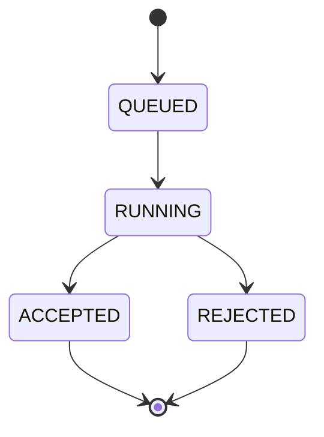

# Async Code Judge: Design Document

## 1. Overview

Async Code Judge is a backend service for judging code submissions. A client
submits code for a given language and immediately receives a submission id with
status `QUEUED`. Judging happens in the background (planned), and the client
polls `GET /api/submissions/{id}` to see the result.

This document describes the Week 1 state: the REST API, the data model and the
layered structure. The background judging worker is not built yet (see
Future Work).

## 2. Goals and Non-goals

**Goals**

- Accept a submission and respond immediately, without waiting for judging
- Persist every submission in PostgreSQL
- Expose a clean REST API with correct status codes
- Return consistent, structured error responses

**Non-goals (for now)**

- Authentication and authorization
- Actually executing or judging code
- Horizontal scaling of workers
- Pagination of the submission list

## 3. Architecture

The app is split into four layers, each with one job:

| Layer | Package | Responsibility |
|---|---|---|
| Controller | `com.mohit.asyn_code_judge.controller` | HTTP only: routes, request parsing, status codes |
| Service | `com.mohit.asyn_code_judge.service` | Business rules (language validation, status handling) |
| Repository | `com.mohit.asyn_code_judge.repository` | Database access through Spring Data JPA |
| Entity | `com.mohit.asyn_code_judge.entity` | Java classes mapped to database tables |

A request flows `Client -> Controller -> Service -> Repository -> PostgreSQL`.
Each layer only talks to the one below it. Controllers never touch the
database, and repositories never know about HTTP.

Dependencies are wired by Spring's dependency injection (constructor
injection), so each class receives what it needs instead of creating it.

Errors are handled in one place by a `GlobalExceptionHandler`
(`@RestControllerAdvice`), so controllers stay free of try/catch blocks.

## 4. Data Model

Table `submissions`:

| Column | Type | Constraints | Notes |
|---|---|---|---|
| id | bigint | PK, identity | Generated by the database |
| language | varchar | NOT NULL | Stored lowercase, e.g. `java` |
| status | varchar | NOT NULL | Enum `SubmissionStatus` stored as a string |

**Status lifecycle**



Only `QUEUED` is used today. The other transitions belong to the future
judging worker.

## 5. API

Base path: `/api/submissions`

| Method | Path | Description | Success | Errors |
|---|---|---|---|---|
| GET | `/api/submissions` | List all submissions | 200 | none |
| GET | `/api/submissions?status=QUEUED` | List submissions with the given status | 200 | 400 invalid status value |
| GET | `/api/submissions/{id}` | Get one submission | 200 | 400 non-numeric id, 404 not found |
| POST | `/api/submissions` | Create a submission with status `QUEUED` | 201 + `Location` header | 400 invalid body, 400 unsupported language |
| DELETE | `/api/submissions/{id}` | Delete a submission | 204 | 404 not found |

**Create request**

```json
{
  "language": "java"
}
```

**Create response (201)**

```json
{
  "id": 1,
  "language": "java",
  "status": "QUEUED"
}
```

**Error response shape** 

```json
{
  "status": 404,
  "error": "Not Found",
  "message": "Submission 99 not found"
}
```

Every error, including validation, malformed JSON and type mismatches, uses
this same shape.

## 6. Key Decisions

**Decision 1: Store `status` as a string, not an ordinal.**
Alternative: the default `EnumType.ORDINAL`, which stores 0, 1, 2, 3.
Reason: with ordinals, inserting or reordering an enum value silently changes
the meaning of existing rows. Strings stay correct and are readable in psql.

**Decision 2: Use a DTO (`CreateSubmissionRequest`) for input instead of the entity.**
Alternative: accept the `Submission` entity directly in `@RequestBody`.
Reason: the client should not be able to set `id` or `status`. A DTO exposes
only the fields the client is allowed to send, and it is where validation
annotations live.

**Decision 3: Centralized error handling with `@RestControllerAdvice`.**
Alternative: try/catch in every controller method.
Reason: one handler gives every endpoint the same error shape and keeps
controllers short. Adding a new exception means adding one handler method.

**Decision 4: Supported languages come from configuration (`judge.supported-languages`).**
Alternative: hardcode a list in the service.
Reason: adding a language becomes a config change, not a code change. A
`LanguagePolicy` bean owns the check, so the rule has one home.

**Decision 5: `spring.jpa.hibernate.ddl-auto=update` during development.**
Alternative: versioned migrations with Flyway or Liquibase.
Reason: fastest way to iterate while the schema is still changing. This is
not safe for production and should be replaced by migrations.

**Decision 6: Language normalization to lowercase.**
Where it lives:in the service before saving.
Reason:`Java` and `java` are treated as the same language and
queries stay simple.

## 7. Future Work

- Background worker that picks up `QUEUED` submissions and moves them to
  `RUNNING`, then `ACCEPTED` or `REJECTED`
- Fields for source code, result output and timestamps
- Database migrations with Flyway instead of `ddl-auto=update`
- Pagination for the list endpoint
- Authentication
- Automated tests for the controller and service layers